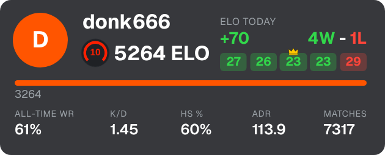
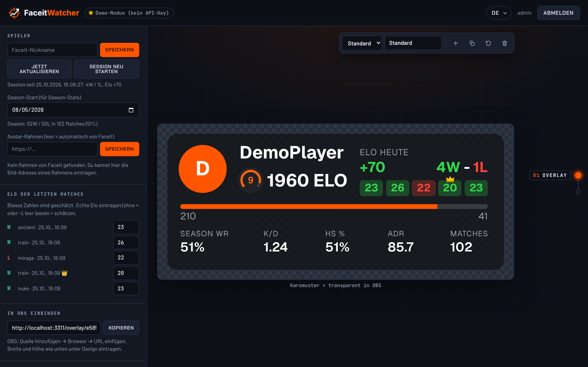
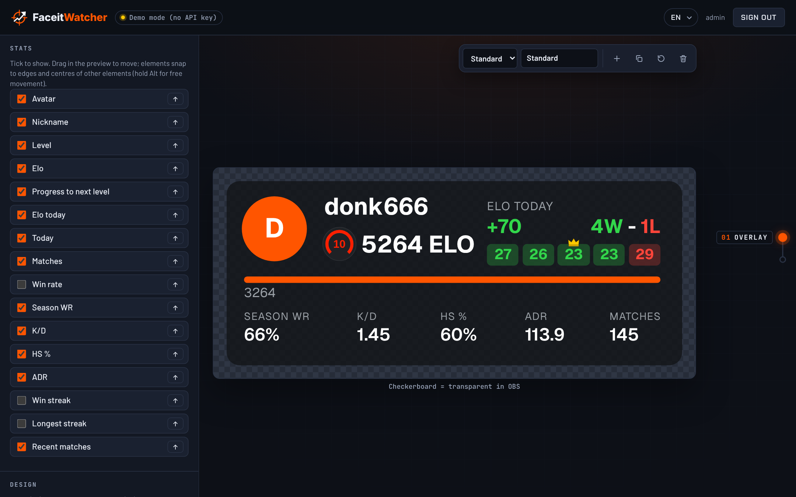
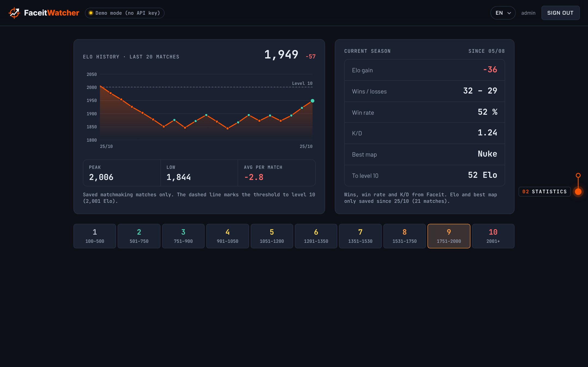

<h1>
  <picture>
    <source media="(prefers-color-scheme: dark)" srcset="public/logo-animated.svg">
    
  </picture>
</h1>

Build your own Faceit overlays (Elo, level, K/D, session stats, …) for OBS and host them yourself. The server polls Faceit and stores your statistics, you design the overlay in the editor, and OBS shows it as a browser source.

<p align="center">
  
</p>

## What it looks like

**Editor:** design the overlay live, drag elements into place, copy the OBS link.



**Pick your stats:** every stat can be shown or hidden on its own and reordered. Fonts and colours are set under **Design**.



**Statistics:** Elo history of your last 20 matches, the current season and all Faceit levels at a glance.



The screenshots use the stats of donk (Faceit donk666, as of Oct 25, 2026), played back in demo mode. The editor is available in English, German, Russian and French.

## Requirements

- [Node.js](https://nodejs.org) 22.13 or newer
- A Faceit API key (without a key everything runs in demo mode with sample data)

## Getting a Faceit API key

1. Log in at [developers.faceit.com](https://developers.faceit.com).
2. Create an app in the **App Studio**.
3. Under **API Keys**, create a key of type **Server side**.

## Setup and start

```bash
git clone https://github.com/Fersehet/FaceitWatchr.git
cd FaceitWatchr
npm install
cp .env.example .env   # Windows: copy .env.example .env
```

Put at least this into `.env`:

```env
FACEIT_API_KEY=your-key
ADMIN_PASSWORD=a-long-password
```

Then start it:

```bash
npm start
```

Open **http://localhost:3000** in your browser and sign in with user `admin` and your password. Enter your Faceit nickname in the editor and design your overlay.

## Adding it to OBS

1. In the editor under **Add to OBS**, copy the URL, e.g. `http://localhost:3000/overlay/abcd1234`.
2. In OBS choose **Add source → Browser** and paste the URL.
3. Enter the width and height shown in the editor under **Design**.

If the server runs on another machine, use its IP instead of `localhost`. Overlays can be read without signing in, the editor cannot.

## Updating

```bash
git pull
npm install
npm start
```

Your overlays and statistics live in `data/` and are kept. More settings (port, poll interval, storage location) are listed in `.env.example`.
